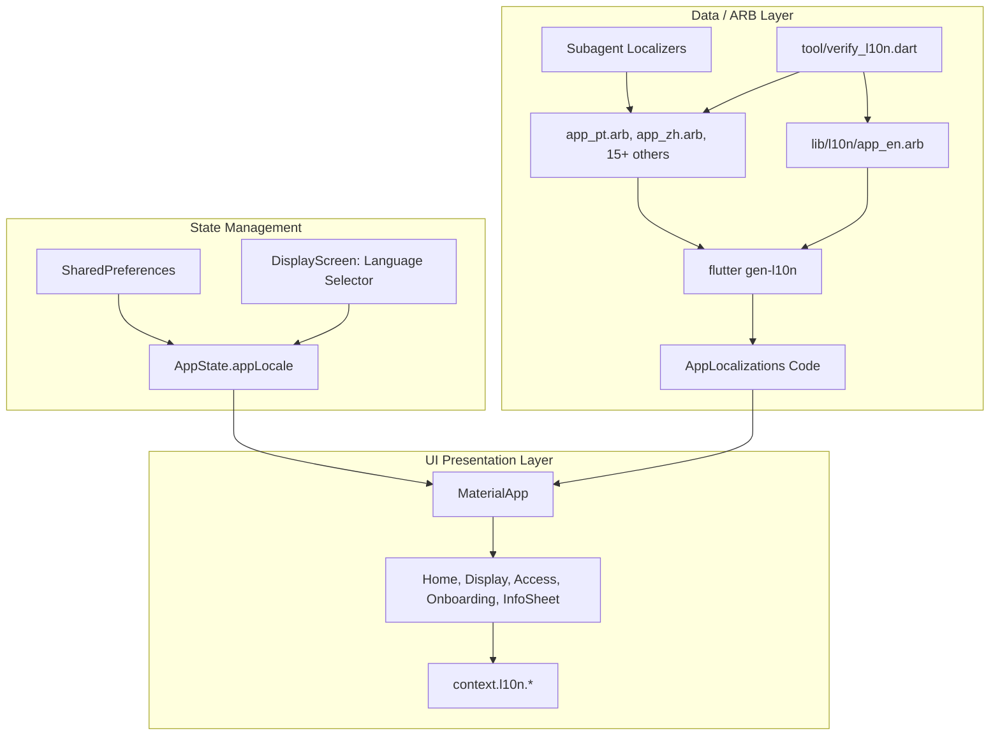

# Internationalization (i18n) Implementation Plan

> **For agentic workers:** REQUIRED SUB-SKILL: Use superpowers:subagent-driven-development to implement this plan task-by-task. Steps use checkbox (`- [ ]`) syntax for tracking.

**Goal:** Transform MoniTune into a fully internationalized application by extracting 100% of UI strings into an ARB catalog, implementing stateful locale selection in the UI, and executing a high-fidelity subagent translation pipeline supporting 17 global languages.

**Architecture:** Utilize Flutter's official compile-time `gen-l10n` toolchain backed by a `context.l10n` extension. Expose user-configurable language selection inside `AppState` with automatic fallback to device system locale and persistence in `SharedPreferences`. Run an automated ARB validator tool to enforce 100% key parity across all subagent-translated locales.

**Architecture Diagram:**



**Tech Stack:** Flutter 3.47.2 / Dart 3.13.2, `flutter_localizations`, `intl`, `provider`, `shared_preferences`.

**Spec:** [`docs/superpowers/specs/2026-10-26-internationalization-design.md`](file:///home/adriansc/Projects/Monitune/docs/superpowers/specs/2026-10-26-internationalization-design.md)

## Global Constraints

- Flutter binary: `/home/adriansc/flutter/bin/flutter` (or run via PATH if loaded)
- Zero third-party runtime localization packages (use first-party `flutter_localizations` only)
- Extension method `context.l10n` must be used across all screens for string retrieval
- All ARB placeholder tokens (`{seconds}`, `{dpi}`, etc.) must be strictly preserved across all translated `.arb` files
- Automated validator `tool/verify_l10n.dart` must pass with 0 errors across all 17 target locales before completion

---

### Task 1: Setup i18n Toolchain & Base Extension

**Files:**
- Modify: `pubspec.yaml`
- Create: `l10n.yaml`
- Create: `lib/l10n/l10n.dart`
- Create: `lib/l10n/app_en.arb` (minimal seed)
- Modify: `test/screens_smoke_test.dart`

**Interfaces:**
- Consumes: Flutter SDK `flutter_localizations`
- Produces: `lib/l10n/l10n.dart` (`extension AppLocalizationsX on BuildContext { AppLocalizations get l10n => ... }`)

- [ ] **Step 1: Write initial test checking for localization delegate initialization**

In `test/widget_test.dart`:
```dart
testWidgets('AppLocalizations delegates load correctly for en', (tester) async {
  await tester.pumpWidget(
    const MaterialApp(
      localizationsDelegates: AppLocalizations.localizationsDelegates,
      supportedLocales: AppLocalizations.supportedLocales,
      home: SizedBox(),
    ),
  );
  expect(tester.takeException(), isNull);
});
```

- [ ] **Step 2: Run test to verify it fails**

Run: `/home/adriansc/flutter/bin/flutter test test/widget_test.dart`  
Expected: FAIL (`AppLocalizations` not found)

- [ ] **Step 3: Update `pubspec.yaml`, create `l10n.yaml`, minimal `app_en.arb`, and `l10n.dart`**

In `pubspec.yaml`:
```yaml
dependencies:
  flutter:
    sdk: flutter
  flutter_localizations:
    sdk: flutter
  intl: any
  # (existing dependencies)

flutter:
  generate: true
  uses-material-design: true
  fonts:
    # ...
```

In `l10n.yaml`:
```yaml
arb-dir: lib/l10n
template-arb-file: app_en.arb
output-localization-file: app_localizations.dart
nullable-getter: false
```

In `lib/l10n/app_en.arb`:
```json
{
  "@@locale": "en",
  "appTitle": "MoniTune",
  "@appTitle": {
    "description": "The title of the application"
  }
}
```

In `lib/l10n/l10n.dart`:
```dart
import 'package:flutter/widgets.dart';
import 'package:monitune/l10n/app_localizations.dart';

export 'package:monitune/l10n/app_localizations.dart';

extension AppLocalizationsX on BuildContext {
  AppLocalizations get l10n => AppLocalizations.of(this);
}
```

- [ ] **Step 4: Generate localizations and run tests**

Run:
```bash
/home/adriansc/flutter/bin/flutter gen-l10n
/home/adriansc/flutter/bin/flutter test test/widget_test.dart
```
Expected: PASS

- [ ] **Step 5: Commit**

```bash
git add pubspec.yaml l10n.yaml lib/l10n/ test/widget_test.dart
git commit -m "feat(i18n): setup flutter gen-l10n toolchain and base extension"
```

---

### Task 2: Master English ARB Catalog Extraction

**Files:**
- Modify: `lib/l10n/app_en.arb`

**Interfaces:**
- Consumes: Existing hardcoded string inventory from `lib/screens/`, `lib/widgets/ui.dart`, `lib/main.dart`
- Produces: Complete `lib/l10n/app_en.arb` with full `@metadata` and typed ICU placeholders.

- [ ] **Step 1: Extract all strings from all UI files into `lib/l10n/app_en.arb`**

Categories to extract:
1. `common_*`: Cancel, Done, Save, Close, Revert, Reset, Learn more, Back, Continue.
2. `home_*`:
   - Connection statuses: "External display connected", "No external display detected".
   - Service controls: "Monitor watcher active", "Monitor watcher stopped".
   - Active profile labels: "{width}x{height} @ {scale}% ({dpi} DPI)".
   - Test actions: "Test Profile (15s)", "Keep Settings", "Revert Now".
   - Countdown banner: "Auto-reverting in {seconds}s unless confirmed".
   - Screen-off emergency hint: "Turn screen off (Power button) to instantly cancel & revert".
3. `display_*`:
   - Section headers: "Display Presets", "Custom Resolution", "UI Scaling", "Launcher & Orientation", "Appearance", "Language".
   - Preset buttons: "1080p", "1440p", "4K", "Ultrawide (1080p)", "Ultrawide (1440p)", "Native", "Custom".
   - Explanatory toggles: "Launcher-safe mode (keep icon grid intact)", "Force Landscape (override portrait launchers)".
   - Appearance options: Dynamic Scheme variant names, Contrast Boost.
   - Language selector labels: "System default ({language})", "Language".
4. `access_*`:
   - Permission titles and descriptions: "Write Secure Settings", "Shizuku Service", "Root Privilege", "Display Over Other Apps", "Modify System Settings", "Notifications", "Battery Optimization".
   - Status indicators: "Granted", "Missing", "Not running".
   - Instructions and ADB grant command.
5. `onboarding_*`:
   - 4-step onboarding slides: Welcome title, explanation, feature intros, permissions setup, finish button.
6. `info_*`:
   - Version row, check for updates button, update check statuses ("Checking...", "You're up to date", "New version {version} available", "Open GitHub Releases").

- [ ] **Step 2: Generate localizations and verify syntax**

Run:
```bash
/home/adriansc/flutter/bin/flutter gen-l10n
```
Expected: PASS with 0 syntax errors or warnings.

- [ ] **Step 3: Commit**

```bash
git add lib/l10n/app_en.arb
git commit -m "feat(i18n): extract full master English ARB catalog"
```

---

### Task 3: AppState Locale Management & Main Wiring

**Files:**
- Modify: `lib/state/app_state.dart`
- Modify: `lib/main.dart`
- Test: `test/screens_smoke_test.dart`

**Interfaces:**
- Consumes: `AppLocalizations.supportedLocales`, `AppLocalizations.localizationsDelegates`
- Produces: `AppState.selectedLanguageCode`, `AppState.appLocale`, `AppState.setLanguage(String?)`

- [ ] **Step 1: Write test for locale switching in `AppState`**

In `test/screens_smoke_test.dart`:
```dart
test('AppState updates locale and persists to SharedPreferences', () async {
  SharedPreferences.setMockInitialValues({});
  final state = AppState();
  await state.initialize();
  expect(state.appLocale, isNull); // Default system locale

  await state.setLanguage('pt');
  expect(state.appLocale, const Locale('pt'));
  expect(state.selectedLanguageCode, 'pt');

  await state.setLanguage(null);
  expect(state.appLocale, isNull);
});
```

- [ ] **Step 2: Run test to verify it fails**

Run: `/home/adriansc/flutter/bin/flutter test test/screens_smoke_test.dart`  
Expected: FAIL (`setLanguage` / `appLocale` not defined)

- [ ] **Step 3: Implement locale state in `AppState` and wire `main.dart`**

In `lib/state/app_state.dart`:
```dart
static const String _keyLanguageCode = 'pref_language_code';
String? _selectedLanguageCode;

String? get selectedLanguageCode => _selectedLanguageCode;
Locale? get appLocale => _selectedLanguageCode != null ? Locale(_selectedLanguageCode!) : null;

Future<void> setLanguage(String? code) async {
  if (_selectedLanguageCode == code) return;
  _selectedLanguageCode = code;
  final prefs = await SharedPreferences.getInstance();
  if (code == null) {
    await prefs.remove(_keyLanguageCode);
  } else {
    await prefs.setString(_keyLanguageCode, code);
  }
  notifyListeners();
}
```

In `lib/main.dart`:
Wire `localizationsDelegates: AppLocalizations.localizationsDelegates`, `supportedLocales: AppLocalizations.supportedLocales`, `locale: state.appLocale`.

- [ ] **Step 4: Run test to verify it passes**

Run: `/home/adriansc/flutter/bin/flutter test test/screens_smoke_test.dart`  
Expected: PASS

- [ ] **Step 5: Commit**

```bash
git add lib/state/app_state.dart lib/main.dart test/screens_smoke_test.dart
git commit -m "feat(i18n): wire locale state management and MaterialApp localizations"
```

---

### Task 4: Refactor UI Screens & Add Language Selector

**Files:**
- Modify: `lib/widgets/ui.dart`
- Modify: `lib/screens/home_screen.dart`
- Modify: `lib/screens/display_screen.dart`
- Modify: `lib/screens/access_screen.dart`
- Modify: `lib/screens/onboarding/onboarding_flow.dart`
- Modify: `lib/screens/app_info_sheet.dart`
- Test: `test/screens_smoke_test.dart`

**Interfaces:**
- Consumes: `context.l10n.*`, `AppState.setLanguage(String?)`
- Produces: Complete UI rendering with localized strings and interactive Language picker sheet.

- [ ] **Step 1: Write test for Language Selector Sheet in `DisplayScreen`**

In `test/screens_smoke_test.dart`:
```dart
testWidgets('display screen renders language selector and opens picker sheet', (tester) async {
  // Build DisplayScreen with AppLocalizations and AppState
  // Verify Language section tile exists
  // Tap Language tile and verify bottom sheet appears with System default option
});
```

- [ ] **Step 2: Run test to verify it fails**

Run: `/home/adriansc/flutter/bin/flutter test test/screens_smoke_test.dart`  
Expected: FAIL

- [ ] **Step 3: Refactor screens to use `context.l10n` and implement Language Selector**

1. Replace all hardcoded strings with `context.l10n.<key>`.
2. In `lib/screens/display_screen.dart`, add the Language row inside `sectionTitle(context, context.l10n.displaySectionAppearance)`:
   - On tap, shows `showModalBottomSheet` containing a list of supported languages (autonym native titles).
   - Tapping an item calls `context.read<AppState>().setLanguage(code)` and dismisses sheet.
3. Refactor `home_screen.dart`, `access_screen.dart`, `onboarding_flow.dart`, `app_info_sheet.dart`, and `ui.dart`.

- [ ] **Step 4: Run tests and static analysis**

Run:
```bash
/home/adriansc/flutter/bin/flutter analyze
/home/adriansc/flutter/bin/flutter test
```
Expected: All tests pass with 0 warnings.

- [ ] **Step 5: Commit**

```bash
git add lib/screens/ lib/widgets/ test/
git commit -m "feat(i18n): refactor all screens to localized strings and add language selector"
```

---

### Task 5: Android Foreground Service Notification Localization

**Files:**
- Create: `android/app/src/main/res/values/strings.xml`
- Modify: `android/app/src/main/kotlin/com/goodeesh/monitune/display/ExternalDisplayService.kt`
- Modify: `android/app/src/main/kotlin/com/goodeesh/monitune/display/OrientationOverlayService.kt`

**Interfaces:**
- Consumes: Android string resources `R.string.notif_*`
- Produces: Localized notification channel names and descriptions in Kotlin services.

- [ ] **Step 1: Create `values/strings.xml` with notification string keys**

```xml
<?xml version="1.0" encoding="utf-8"?>
<resources>
    <string name="notif_external_display_channel_name">External Display Service</string>
    <string name="notif_external_display_channel_desc">Monitors external display connection events to auto-apply profiles</string>
    <string name="notif_external_display_title">MoniTune Service Active</string>
    <string name="notif_external_display_desc">Watching for external display connection</string>
    <string name="notif_orientation_channel_name">Orientation Overlay Service</string>
    <string name="notif_orientation_channel_desc">Maintains landscape orientation lock</string>
    <string name="notif_orientation_title">Force Landscape Active</string>
    <string name="notif_orientation_desc">Holding landscape orientation</string>
</resources>
```

- [ ] **Step 2: Update Kotlin services to use `getString(R.string.notif_...)`**

In `ExternalDisplayService.kt` and `OrientationOverlayService.kt`:
Replace hardcoded notification titles, channel names, and descriptions with `getString(R.string.<key>)`.

- [ ] **Step 3: Verify Kotlin compilation**

Run:
```bash
/home/adriansc/flutter/bin/flutter build apk --debug
```
Expected: Build succeeds without compilation errors.

- [ ] **Step 4: Commit**

```bash
git add android/app/src/main/res/values/strings.xml android/app/src/main/kotlin/
git commit -m "feat(i18n): localize Android foreground notification strings"
```

---

### Task 6: Automated ARB Parity & Integrity Validator Tool

**Files:**
- Create: `tool/verify_l10n.dart`
- Test: Run tool via Dart CLI

**Interfaces:**
- Consumes: `lib/l10n/app_*.arb`
- Produces: Command line exit code 0 on parity success; exit code 1 with detailed mismatch report on error.

- [ ] **Step 1: Implement `tool/verify_l10n.dart`**

Write a Dart script that:
1. Loads `lib/l10n/app_en.arb` as the canonical template.
2. Extracts all non-metadata keys (excluding `@...` keys) and parses all `{placeholder}` tokens inside each value.
3. Iterates over every other `app_<locale>.arb` in `lib/l10n/`:
   - Validates JSON parsing.
   - Detects missing keys (present in English, absent in locale).
   - Detects extra keys (absent in English, present in locale).
   - Detects placeholder mismatches (e.g., English has `{seconds}` but locale has `{segundos}` or missing `{seconds}`).
4. Prints clear summary and exits with code 1 if any failure occurs.

- [ ] **Step 2: Run validator against current catalog**

Run:
```bash
/home/adriansc/flutter/bin/flutter pub run tool/verify_l10n.dart
```
Expected: PASS (0 mismatches).

- [ ] **Step 3: Commit**

```bash
git add tool/verify_l10n.dart
git commit -m "test(i18n): add automated ARB parity and placeholder validator tool"
```

---

### Task 7: Subagent Translation Pipeline Execution for 17 Locales

**Files:**
- Create: `lib/l10n/app_pt_BR.arb` (Brazilian Portuguese)
- Create: `lib/l10n/app_zh.arb` (Simplified Chinese)
- Create: `lib/l10n/app_es.arb` (Spanish)
- Create: `lib/l10n/app_fr.arb` (French)
- Create: `lib/l10n/app_it.arb` (Italian)
- Create: `lib/l10n/app_de.arb` (German)
- Create: `lib/l10n/app_nl.arb` (Dutch)
- Create: `lib/l10n/app_pl.arb` (Polish)
- Create: `lib/l10n/app_ja.arb` (Japanese)
- Create: `lib/l10n/app_ko.arb` (Korean)
- Create: `lib/l10n/app_zh_Hant.arb` (Traditional Chinese)
- Create: `lib/l10n/app_ru.arb` (Russian)
- Create: `lib/l10n/app_tr.arb` (Turkish)
- Create: `lib/l10n/app_hi.arb` (Hindi)
- Create: `lib/l10n/app_ar.arb` (Arabic)
- Create: `lib/l10n/app_id.arb` (Indonesian)
- Create: `lib/l10n/app_vi.arb` (Vietnamese)
- Create corresponding Android `values-<lang>/strings.xml` for foreground services.

**Interfaces:**
- Consumes: Canonical `app_en.arb` + Native Android Localization Persona prompt
- Produces: 17 fully translated `.arb` files + Android notification string files

- [ ] **Step 1: Dispatch Batch 1 (Requested: `pt_BR`, `zh`)**
  Dispatch subagent with native persona to translate Brazilian Portuguese and Simplified Chinese.
- [ ] **Step 2: Dispatch Batch 2 (Romance: `es`, `fr`, `it`)**
  Dispatch subagent for Spanish, French, and Italian.
- [ ] **Step 3: Dispatch Batch 3 (Germanic & Central European: `de`, `nl`, `pl`)**
  Dispatch subagent for German, Dutch, and Polish.
- [ ] **Step 4: Dispatch Batch 4 (East Asian & Cyrillic: `ja`, `ko`, `zh_Hant`, `ru`)**
  Dispatch subagent for Japanese, Korean, Traditional Chinese, and Russian.
- [ ] **Step 5: Dispatch Batch 5 (South/SE Asian & Middle Eastern: `ar`, `hi`, `tr`, `id`, `vi`)**
  Dispatch subagent for Arabic, Hindi, Turkish, Indonesian, and Vietnamese.
- [ ] **Step 6: Run `tool/verify_l10n.dart` and `flutter gen-l10n`**
  Verify all 17 locale catalogs have 100% key parity and compile cleanly.
- [ ] **Step 7: Commit**

```bash
git add lib/l10n/ android/app/src/main/res/values-*/
git commit -m "feat(i18n): add 17 natural language translations via subagent pipeline"
```

---

### Task 8: Comprehensive Multi-Locale Verification & Smoke Tests

**Files:**
- Create: `test/l10n_smoke_test.dart`
- Modify: `test/screens_smoke_test.dart`

**Interfaces:**
- Consumes: All 17 generated localizations
- Produces: Multi-locale automated test suite verifying rendering across locales (including CJK and RTL).

- [ ] **Step 1: Write `test/l10n_smoke_test.dart`**

```dart
testWidgets('all primary screens render without exception in representative locales', (tester) async {
  final testLocales = [
    const Locale('en'),
    const Locale('pt', 'BR'),
    const Locale('zh'),
    const Locale('de'),
    const Locale('ar'), // RTL verification
  ];

  for (final locale in testLocales) {
    // Build App with specified locale
    // Pump HomeScreen, DisplayScreen, AccessScreen, OnboardingFlow
    // Verify no widget overflow, no missing strings, no layout exceptions
  }
});
```

- [ ] **Step 2: Run full test suite and validation**

Run:
```bash
/home/adriansc/flutter/bin/flutter pub run tool/verify_l10n.dart
/home/adriansc/flutter/bin/flutter test
/home/adriansc/flutter/bin/flutter analyze
```
Expected: 100% tests pass, 0 analyzer issues, 0 missing localization keys.

- [ ] **Step 3: Commit**

```bash
git add test/l10n_smoke_test.dart
git commit -m "test(i18n): add multi-locale smoke test suite"
```
