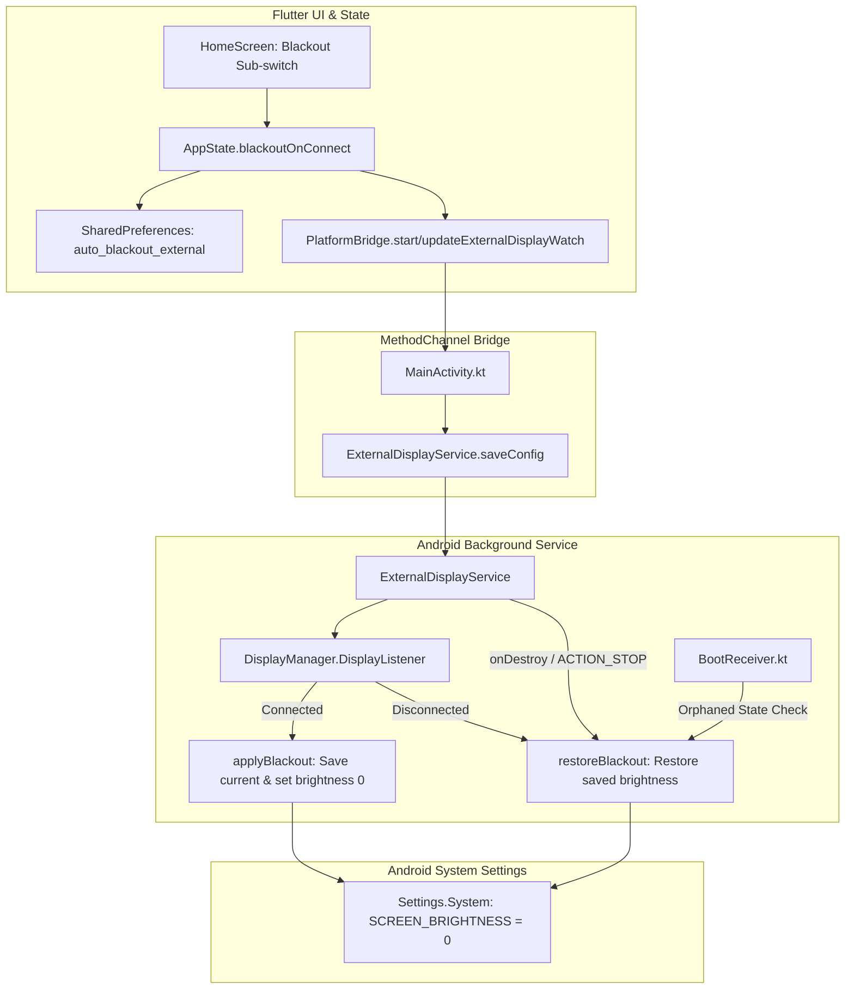

# Auto-Apply Screen Blackout Implementation Plan

> **For agentic workers:** REQUIRED SUB-SKILL: Use superpowers:subagent-driven-development to implement this plan task-by-task. Steps use checkbox (`- [ ]`) syntax for tracking.

**Goal:** Implement an automated zero-brightness screen blackout sub-option for MoniTune's auto-apply feature, allowing the phone screen to dim completely to zero on connect under Permanent Access Active (`WRITE_SECURE_SETTINGS`) without requiring Shizuku at runtime, and cleanly restoring brightness upon disconnect.

**Architecture:** Extend `HomeScreen` to render an indented "Blackout phone screen" sub-switch governed by `AppState` when `autoApplyOnExternalDisplay` is enabled. Propagate the configuration via `PlatformBridge` to Android's `ExternalDisplayService`, which caches the user's brightness and brightness mode in `SharedPreferences` upon external display connection, sets `Settings.System.SCREEN_BRIGHTNESS` to 0, and restores original values on disconnect, app exit, or boot recovery.

**Architecture Diagram:**



**Tech Stack:** Flutter 3.47.2 / Dart 3.13.2, Android SDK 34 / Kotlin, `Settings.System`, `SharedPreferences`.

**Spec:** [`docs/superpowers/specs/2026-10-27-screen-blackout-auto-apply-design.md`](file:///home/adriansc/Projects/Monitune/docs/superpowers/specs/2026-10-27-screen-blackout-auto-apply-design.md)

## Global Constraints

- Flutter binary: `/home/adriansc/flutter/bin/flutter`
- No runtime Shizuku or root dependency for blackout; must work strictly under Permanent Access Active (`WRITE_SECURE_SETTINGS`)
- The blackout sub-option must only be active/enabled when auto-apply is `true`
- Screen brightness must always be restored safely on disconnect, service teardown, or unclean reboot
- 100% ARB translation key parity across all 18 supported locales verified by `tool/verify_l10n.dart`
- Zero test regressions across the full Flutter test suite

---

### Task 1: Add Localized Strings for Blackout Sub-Option Across All 18 Locales

**Files:**
- Modify: `lib/l10n/app_en.arb`
- Modify: `lib/l10n/app_ar.arb`
- Modify: `lib/l10n/app_de.arb`
- Modify: `lib/l10n/app_es.arb`
- Modify: `lib/l10n/app_fr.arb`
- Modify: `lib/l10n/app_hi.arb`
- Modify: `lib/l10n/app_id.arb`
- Modify: `lib/l10n/app_it.arb`
- Modify: `lib/l10n/app_ja.arb`
- Modify: `lib/l10n/app_ko.arb`
- Modify: `lib/l10n/app_nl.arb`
- Modify: `lib/l10n/app_pl.arb`
- Modify: `lib/l10n/app_pt.arb`
- Modify: `lib/l10n/app_pt_BR.arb`
- Modify: `lib/l10n/app_ru.arb`
- Modify: `lib/l10n/app_tr.arb`
- Modify: `lib/l10n/app_vi.arb`
- Modify: `lib/l10n/app_zh.arb`
- Modify: `lib/l10n/app_zh_Hant.arb`

**Interfaces:**
- Consumes: `lib/l10n/app_en.arb`
- Produces: `context.l10n.homeAutoApplyBlackoutTitle`, `context.l10n.homeAutoApplyBlackoutSubtitle`

- [ ] **Step 1: Add new keys to `lib/l10n/app_en.arb`**

```json
  "homeAutoApplyBlackoutTitle": "Blackout phone screen",
  "@homeAutoApplyBlackoutTitle": {
    "description": "Sub-option title under Auto-apply to dim phone screen to zero when mirroring"
  },
  "homeAutoApplyBlackoutSubtitle": "Dims phone display to zero on connect (AMOLED recommended)",
  "@homeAutoApplyBlackoutSubtitle": {
    "description": "Sub-option description under Auto-apply explaining brightness zeroing for AMOLED screens"
  }
```

- [ ] **Step 2: Run verification script to confirm parity failure before translation**

Run: `/home/adriansc/flutter/bin/dart run tool/verify_l10n.dart`  
Expected: FAIL indicating missing keys in the other 17 ARB files.

- [ ] **Step 3: Add natural translations to all other 17 `.arb` files**

Add `homeAutoApplyBlackoutTitle` and `homeAutoApplyBlackoutSubtitle` to:
- `app_de.arb`: "Telefonbildschirm abdunkeln", "Dunkelt den Bildschirm beim Verbinden komplett ab (AMOLED empfohlen)"
- `app_es.arb`: "Apagar pantalla del teléfono", "Atenúa la pantalla a cero al conectar (recomendado para AMOLED)"
- `app_fr.arb`: "Écran du téléphone noir", "Réduit la luminosité à zéro lors de la connexion (recommandé pour AMOLED)"
- `app_it.arb`: "Oscura schermo del telefono", "Azzera la luminosità dello schermo alla connessione (consigliato per AMOLED)"
- `app_pt.arb` & `app_pt_BR.arb`: "Apagar tela do celular", "Reduz o brilho da tela a zero ao conectar (recomendado para AMOLED)"
- `app_ru.arb`: "Затемнять экран телефона", "Снижает яркость экрана до нуля при подключении (рекомендуется для AMOLED)"
- `app_zh.arb`: "熄灭手机屏幕", "连接时将手机屏幕亮度调至最低（推荐 AMOLED 屏幕）"
- `app_zh_Hant.arb`: "熄滅手機螢幕", "連線時將手機螢幕亮度調至最低（建議 AMOLED 螢幕）"
- `app_ja.arb`: "スマホの画面を消灯", "接続時に画面の明るさをゼロにします（AMOLED推奨）"
- `app_ko.arb`: "휴대폰 화면 끄기", "연결 시 화면 밝기를 0으로 낮춥니다 (AMOLED 권장)"
- `app_ar.arb`: "إعتام شاشة الهاتف", "يخفض سطوع الشاشة إلى الصفر عند الاتصال (موصى به لشاشات AMOLED)"
- `app_hi.arb`: "फ़ोन स्क्रीन बंद करें", "कनेक्ट होने पर स्क्रीन की चमक शून्य कर देता है (AMOLED के लिए अनुशंसित)"
- `app_id.arb`: "Matikan layar ponsel", "Meredupkan layar ponsel hingga nol saat terhubung (disarankan untuk AMOLED)"
- `app_nl.arb`: "Telefoonscherm verduisteren", "Zet schermhelderheid op nul bij verbinding (AMOLED aanbevolen)"
- `app_pl.arb`: "Wycisz ekran telefonu", "Zmniejsza jasność ekranu do zera po podłączeniu (zalecane dla AMOLED)"
- `app_tr.arb`: "Telefon ekranını karart", "Bağlandığında ekran parlaklığını sıfıra indirir (AMOLED önerilir)"
- `app_vi.arb`: "Tắt màn hình điện thoại", "Giảm độ sáng màn hình về 0 khi kết nối (khuyên dùng cho AMOLED)"

- [ ] **Step 4: Regenerate localizations and verify parity**

Run:
```bash
/home/adriansc/flutter/bin/flutter gen-l10n
/home/adriansc/flutter/bin/dart run tool/verify_l10n.dart
```
Expected: PASS with 100% key parity across all 18 catalogs.

- [ ] **Step 5: Commit**

```bash
git add lib/l10n/
git commit -m "feat(i18n): add blackout sub-option strings across 18 locales"
```

---

### Task 2: Implement State & Persistence in AppState

**Files:**
- Modify: `lib/state/app_state.dart`
- Test: `test/state_test.dart`

**Interfaces:**
- Consumes: Flutter `SharedPreferences`
- Produces: `AppState.blackoutOnConnect`, `AppState.setBlackoutOnConnect(bool)`

- [ ] **Step 1: Write failing test in `test/state_test.dart`**

```dart
test('blackoutOnConnect defaults to false and persists when toggled', () async {
  SharedPreferences.setMockInitialValues({});
  final state = AppState();
  await state.init();

  expect(state.blackoutOnConnect, isFalse);

  await state.setBlackoutOnConnect(true);
  expect(state.blackoutOnConnect, isTrue);

  final prefs = await SharedPreferences.getInstance();
  expect(prefs.getBool('auto_blackout_external'), isTrue);
});

test('disabling autoApplyOnExternalDisplay deactivates blackoutOnConnect', () async {
  SharedPreferences.setMockInitialValues({
    'auto_apply_external': true,
    'auto_blackout_external': true,
  });
  final state = AppState();
  await state.init();

  expect(state.autoApplyOnExternalDisplay, isTrue);
  expect(state.blackoutOnConnect, isTrue);

  await state.setAutoApplyOnExternalDisplay(false);
  expect(state.autoApplyOnExternalDisplay, isFalse);
  expect(state.blackoutOnConnect, isFalse);
});
```

- [ ] **Step 2: Run test to verify it fails**

Run: `/home/adriansc/flutter/bin/flutter test test/state_test.dart`  
Expected: FAIL (`blackoutOnConnect` getter / setter not defined on `AppState`).

- [ ] **Step 3: Implement `blackoutOnConnect` in `lib/state/app_state.dart`**

```dart
// In lib/state/app_state.dart:
bool _blackoutOnConnect = false;
bool get blackoutOnConnect => _blackoutOnConnect;

// In init():
_blackoutOnConnect = _prefs?.getBool('auto_blackout_external') ?? false;

// Method:
Future<void> setBlackoutOnConnect(bool enabled) async {
  _blackoutOnConnect = enabled;
  await _prefs?.setBool('auto_blackout_external', enabled);
  notifyListeners();
  if (_autoApplyOnExternalDisplay && _isAutoWatchRunning) {
    await _updateWatch();
  }
}

// In setAutoApplyOnExternalDisplay(bool enabled):
if (!enabled) {
  _blackoutOnConnect = false;
  await _prefs?.setBool('auto_blackout_external', false);
}
```

And update `_startWatch()` and `_updateWatch()`:
```dart
await MonitunePlatform.startExternalDisplayWatch(
  width: width,
  height: height,
  scalePercent: _uiScalePercent,
  forceLandscape: _forceLandscape,
  applyDensity: !_launcherSafeDisplay,
  autoReset: _autoResetOnDisconnect,
  blackoutPhone: _blackoutOnConnect,
);
```

- [ ] **Step 4: Run test to verify it passes**

Run: `/home/adriansc/flutter/bin/flutter test test/state_test.dart`  
Expected: PASS.

- [ ] **Step 5: Commit**

```bash
git add lib/state/app_state.dart test/state_test.dart
git commit -m "feat(state): add blackoutOnConnect state and persistence"
```

---

### Task 3: Add UI Sub-switch to HomeScreen

**Files:**
- Modify: `lib/screens/home_screen.dart`
- Test: `test/screens_smoke_test.dart`

**Interfaces:**
- Consumes: `AppState.blackoutOnConnect`, `AppState.autoApplyOnExternalDisplay`, `context.l10n.homeAutoApplyBlackoutTitle`
- Produces: UI sub-option on `HomeScreen`

- [ ] **Step 1: Write failing widget test in `test/screens_smoke_test.dart`**

```dart
testWidgets('home screen renders blackout sub-switch only when auto-apply is on', (tester) async {
  final state = AppState();
  SharedPreferences.setMockInitialValues({'auto_apply_external': false});
  await state.init();

  await tester.pumpWidget(
    ChangeNotifierProvider.value(
      value: state,
      child: const MaterialApp(
        localizationsDelegates: AppLocalizations.localizationsDelegates,
        supportedLocales: AppLocalizations.supportedLocales,
        home: Scaffold(body: HomeScreen()),
      ),
    ),
  );
  await tester.pumpAndSettle();

  // With auto-apply OFF, blackout switch should not be visible or enabled
  expect(find.text('Blackout phone screen'), findsNothing);

  // Turn auto-apply ON
  await state.setAutoApplyOnExternalDisplay(true);
  await tester.pumpAndSettle();

  expect(find.text('Blackout phone screen'), findsOneWidget);
});
```

- [ ] **Step 2: Run test to verify it fails**

Run: `/home/adriansc/flutter/bin/flutter test test/screens_smoke_test.dart`  
Expected: FAIL (text 'Blackout phone screen' not found).

- [ ] **Step 3: Implement sub-option in `lib/screens/home_screen.dart`**

Directly beneath the `autoApply` `SwitchListTile`:
```dart
if (state.autoApplyOnExternalDisplay) ...[
  Padding(
    padding: const EdgeInsets.only(left: 16.0),
    child: SwitchListTile(
      contentPadding: EdgeInsets.zero,
      title: Text(
        context.l10n.homeAutoApplyBlackoutTitle,
        style: tokens.bodyMd.copyWith(color: tokens.textPrimary),
      ),
      subtitle: Text(
        context.l10n.homeAutoApplyBlackoutSubtitle,
        style: tokens.bodySm,
      ),
      value: state.blackoutOnConnect,
      onChanged: (v) => state.setBlackoutOnConnect(v),
    ),
  ),
],
```

- [ ] **Step 4: Run test to verify it passes**

Run: `/home/adriansc/flutter/bin/flutter test test/screens_smoke_test.dart`  
Expected: PASS.

- [ ] **Step 5: Commit**

```bash
git add lib/screens/home_screen.dart test/screens_smoke_test.dart
git commit -m "feat(ui): add blackout phone screen sub-switch under auto-apply"
```

---

### Task 4: Update PlatformBridge & MainActivity MethodChannel

**Files:**
- Modify: `lib/services/platform_bridge.dart`
- Modify: `android/app/src/main/kotlin/com/goodeesh/monitune/MainActivity.kt`

**Interfaces:**
- Consumes: `AppState` watch calls
- Produces: `blackoutPhone` argument forwarded from Flutter to Android

- [ ] **Step 1: Update `PlatformBridge` method signatures and arguments**

In `lib/services/platform_bridge.dart`:
```dart
static Future<bool> startExternalDisplayWatch({
  required int width,
  required int height,
  required int scalePercent,
  required bool forceLandscape,
  required bool applyDensity,
  required bool autoReset,
  required bool blackoutPhone,
}) async {
  final result = await _channel.invokeMethod<bool>('startExternalDisplayWatch', {
    'width': width,
    'height': height,
    'scalePercent': scalePercent,
    'forceLandscape': forceLandscape,
    'applyDensity': applyDensity,
    'autoReset': autoReset,
    'blackoutPhone': blackoutPhone,
  });
  return result ?? false;
}

static Future<bool> updateExternalDisplayWatch({
  required int width,
  required int height,
  required int scalePercent,
  required bool forceLandscape,
  required bool applyDensity,
  required bool autoReset,
  required bool blackoutPhone,
}) async {
  final result = await _channel.invokeMethod<bool>('updateExternalDisplayWatch', {
    'width': width,
    'height': height,
    'scalePercent': scalePercent,
    'forceLandscape': forceLandscape,
    'applyDensity': applyDensity,
    'autoReset': autoReset,
    'blackoutPhone': blackoutPhone,
  });
  return result ?? false;
}
```

- [ ] **Step 2: Update `MainActivity.kt` MethodChannel handlers**

In `android/app/src/main/kotlin/com/goodeesh/monitune/MainActivity.kt`:
```kotlin
"startExternalDisplayWatch" -> {
    ExternalDisplayService.saveConfig(
        this,
        width = call.argument<Int>("width") ?: 1920,
        height = call.argument<Int>("height") ?: 1080,
        scale = call.argument<Int>("scalePercent") ?: 100,
        forceLandscape = call.argument<Boolean>("forceLandscape") ?: true,
        applyDensity = call.argument<Boolean>("applyDensity") ?: true,
        autoReset = call.argument<Boolean>("autoReset") ?: true,
        blackout = call.argument<Boolean>("blackoutPhone") ?: false,
        enabled = true,
    )
    ensureNotificationPermission()
    startDisplayWatchService(ExternalDisplayService.ACTION_START)
    result.success(true)
}

"updateExternalDisplayWatch" -> {
    ExternalDisplayService.saveConfig(
        this,
        width = call.argument<Int>("width") ?: 1920,
        height = call.argument<Int>("height") ?: 1080,
        scale = call.argument<Int>("scalePercent") ?: 100,
        forceLandscape = call.argument<Boolean>("forceLandscape") ?: true,
        applyDensity = call.argument<Boolean>("applyDensity") ?: true,
        autoReset = call.argument<Boolean>("autoReset") ?: true,
        blackout = call.argument<Boolean>("blackoutPhone") ?: false,
        enabled = true,
    )
    startDisplayWatchService(ExternalDisplayService.ACTION_UPDATE)
    result.success(true)
}
```

- [ ] **Step 3: Run Flutter tests to verify no compilation issues**

Run: `/home/adriansc/flutter/bin/flutter test`  
Expected: PASS.

- [ ] **Step 4: Commit**

```bash
git add lib/services/platform_bridge.dart android/app/src/main/kotlin/com/goodeesh/monitune/MainActivity.kt
git commit -m "feat(bridge): wire blackoutPhone argument through MethodChannel"
```

---

### Task 5: Implement Native Brightness Blackout in ExternalDisplayService & BootReceiver

**Files:**
- Modify: `android/app/src/main/kotlin/com/goodeesh/monitune/display/ExternalDisplayService.kt`
- Modify: `android/app/src/main/kotlin/com/goodeesh/monitune/display/BootReceiver.kt`

**Interfaces:**
- Consumes: `monitune_auto` SharedPreferences, `DisplayManager.DisplayListener`
- Produces: Native brightness save/zero/restore lifecycle

- [ ] **Step 1: Add configuration keys and methods to `ExternalDisplayService`**

```kotlin
// In companion object:
const val EXTRA_BLACKOUT = "blackoutPhone"
private const val KEY_BLACKOUT = "blackoutPhone"
private const val KEY_SAVED_BRIGHTNESS = "savedBrightness"
private const val KEY_SAVED_BRIGHTNESS_MODE = "savedBrightnessMode"
private const val KEY_BLACKOUT_ACTIVE = "isBlackoutActive"

fun saveConfig(
    context: Context,
    width: Int,
    height: Int,
    scale: Int,
    forceLandscape: Boolean,
    applyDensity: Boolean,
    autoReset: Boolean,
    blackout: Boolean,
    enabled: Boolean,
) {
    context.getSharedPreferences(PREFS, Context.MODE_PRIVATE).edit()
        .putInt(KEY_WIDTH, width)
        .putInt(KEY_HEIGHT, height)
        .putInt(KEY_SCALE, scale)
        .putBoolean(KEY_FORCE_LANDSCAPE, forceLandscape)
        .putBoolean(KEY_APPLY_DENSITY, applyDensity)
        .putBoolean(KEY_AUTO_RESET, autoReset)
        .putBoolean(KEY_BLACKOUT, blackout)
        .putBoolean(KEY_ENABLED, enabled)
        .apply()
}

fun isBlackoutEnabled(context: Context): Boolean =
    context.getSharedPreferences(PREFS, Context.MODE_PRIVATE).getBoolean(KEY_BLACKOUT, false)

fun restoreBlackout(context: Context) {
    val prefs = context.getSharedPreferences(PREFS, Context.MODE_PRIVATE)
    if (!prefs.getBoolean(KEY_BLACKOUT_ACTIVE, false)) return
    val savedBrightness = prefs.getInt(KEY_SAVED_BRIGHTNESS, -1)
    val savedMode = prefs.getInt(KEY_SAVED_BRIGHTNESS_MODE, -1)
    try {
        if (savedBrightness >= 0) {
            Settings.System.putInt(context.contentResolver, Settings.System.SCREEN_BRIGHTNESS, savedBrightness)
        }
        if (savedMode >= 0) {
            Settings.System.putInt(context.contentResolver, Settings.System.SCREEN_BRIGHTNESS_MODE, savedMode)
        }
        Log.i(TAG, "Restored screen brightness=$savedBrightness mode=$savedMode")
    } catch (e: Throwable) {
        Log.e(TAG, "Failed to restore screen brightness", e)
    } finally {
        prefs.edit()
            .remove(KEY_SAVED_BRIGHTNESS)
            .remove(KEY_SAVED_BRIGHTNESS_MODE)
            .putBoolean(KEY_BLACKOUT_ACTIVE, false)
            .apply()
    }
}
```

- [ ] **Step 2: Add `applyBlackout` in `ExternalDisplayService`**

```kotlin
private fun applyBlackout() {
    val prefs = getSharedPreferences(PREFS, Context.MODE_PRIVATE)
    if (!prefs.getBoolean(KEY_BLACKOUT, false)) return
    if (prefs.getBoolean(KEY_BLACKOUT_ACTIVE, false)) return

    try {
        val currentBrightness = Settings.System.getInt(contentResolver, Settings.System.SCREEN_BRIGHTNESS, 128)
        val currentMode = Settings.System.getInt(contentResolver, Settings.System.SCREEN_BRIGHTNESS_MODE, Settings.System.SCREEN_BRIGHTNESS_MODE_AUTOMATIC)

        prefs.edit()
            .putInt(KEY_SAVED_BRIGHTNESS, currentBrightness)
            .putInt(KEY_SAVED_BRIGHTNESS_MODE, currentMode)
            .putBoolean(KEY_BLACKOUT_ACTIVE, true)
            .apply()

        Settings.System.putInt(contentResolver, Settings.System.SCREEN_BRIGHTNESS_MODE, Settings.System.SCREEN_BRIGHTNESS_MODE_MANUAL)
        Settings.System.putInt(contentResolver, Settings.System.SCREEN_BRIGHTNESS, 0)
        Log.i(TAG, "Applied screen blackout: brightness 0 (saved: $currentBrightness, mode: $currentMode)")
    } catch (e: Throwable) {
        Log.e(TAG, "Failed to apply screen blackout", e)
    }
}
```

- [ ] **Step 3: Integrate with `evaluateDisplays()`, `onDestroy()`, and `ACTION_STOP`**

In `evaluateDisplays()`:
```kotlin
if (connected && !wasConnected) {
    wasConnected = true
    Log.i(TAG, "External display connected — applying profile")
    applyStoredProfile()
    applyBlackout()
} else if (!connected && wasConnected) {
    wasConnected = false
    Log.i(TAG, "External display disconnected")
    restoreBlackout(this)
    if (autoReset()) {
        OrientationLock.release(this)
        thread(name = "monitune-auto-reset") {
            ShizukuDisplayManager.resetDisplay(this)
        }
    }
}
```

In `onDestroy()` and `ACTION_STOP`:
```kotlin
restoreBlackout(this)
```

- [ ] **Step 4: Add boot recovery in `BootReceiver.kt`**

In `BootReceiver.kt`:
```kotlin
// In onReceive:
if (ExternalDisplayService.connectedExternalDisplay(context) == null) {
    ExternalDisplayService.restoreBlackout(context)
}
```

- [ ] **Step 5: Run tests and assemble APK test build**

Run:
```bash
/home/adriansc/flutter/bin/flutter test
./gradlew testDebugUnitTest (in android directory)
```
Expected: PASS.

- [ ] **Step 6: Commit**

```bash
git add android/app/src/main/kotlin/com/goodeesh/monitune/display/
git commit -m "feat(android): implement screen blackout lifecycle in ExternalDisplayService"
```

---

### Task 6: End-to-End Verification & Translation Validation

**Files:**
- Test: `test/`
- Tool: `tool/verify_l10n.dart`

**Interfaces:**
- Consumes: Entire codebase
- Produces: 100% test pass confirmation & clean static analysis

- [ ] **Step 1: Run translation integrity check**

Run: `/home/adriansc/flutter/bin/dart run tool/verify_l10n.dart`  
Expected: PASS with 100% key parity across all 18 catalogs.

- [ ] **Step 2: Run complete Flutter test suite**

Run: `/home/adriansc/flutter/bin/flutter test`  
Expected: PASS (all tests pass).

- [ ] **Step 3: Run static analyzer**

Run: `/home/adriansc/flutter/bin/flutter analyze`  
Expected: 0 issues found.

- [ ] **Step 4: Commit**

```bash
git commit --allow-empty -m "chore: verify end-to-end blackout feature tests and analysis"
```
